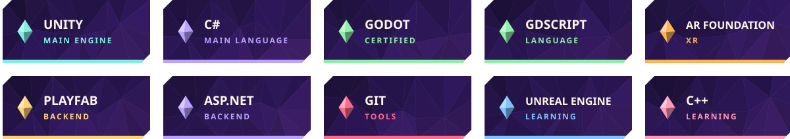

<p align="center">
  
</p>


```txt
> class      : Game Developer
> engines    : Unity · Unreal Engine 5 · Godot
> languages  : C# · C++ · GDScript
> also into  : AR games · multiplayer · mobile
> quest log  : shipping The Mad Clockmaker & Arcade Idle
```


<p align="center">
  
</p>


<p align="center">
  <a href="https://github.com/anasabuhania55-alt/Mazebound"></a>
  <a href="https://github.com/anasabuhania55-alt/Clone"></a>
  <a href="https://github.com/anasabuhania55-alt/SevenStones"></a>
  <a href="https://github.com/anasabuhania55-alt/MeowOverboard"></a>
  <a href="https://github.com/anasabuhania55-alt/basketball-AR"></a>
  <a href="https://github.com/anasabuhania55-alt/AR-Recycling-Assistant-Ai"></a>
</p>


<p align="center">
  
  
</p>

<p align="center">
  
</p>
